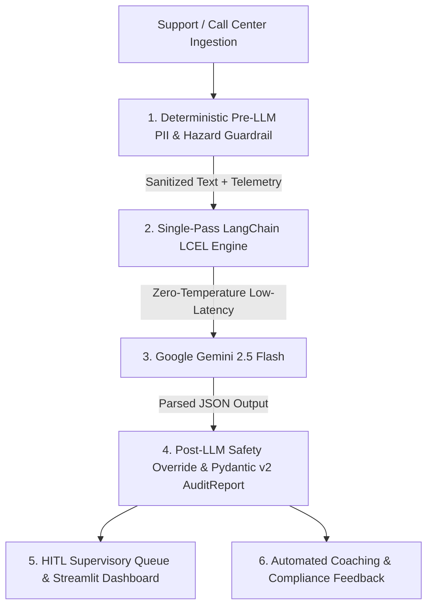

# QualityOps AI — Enterprise Compliance & SRE Audit Platform

[](https://github.com/jraphaelcunha/qualityops-ai-agent)


> **[ Ler em Português ](README.pt-br.md)**

> **Executive Overview:** QualityOps is a compliance auditing and Site Reliability Engineering (SRE) platform built to automate quality assurance across customer support interactions in mission-critical field service operations, specifically **Pest Control Operators (PCOs)**. The system audits transcripts for chemical safety protocols, service warranties, and regulatory compliance while enforcing deterministic pre-LLM PII sanitization, low-latency LangChain LCEL orchestration (`<2.0s`), post-LLM deterministic safety overrides, and strict Pydantic v2 data contracts.

For detailed architectural trade-offs and latency optimization decisions, see [docs/ARCHITECTURE.md](docs/ARCHITECTURE.md).

---

## Intellectual Property & Data Sanitization Governance

> [!NOTE]
> **Sanitized Reference Architecture (NDA, LGPD & PCI-DSS Compliant):**
> This public repository is an anonymized, open-source reference architecture extracted from consulting workflows. Client-proprietary policies, live call recordings, and production credentials remain strictly private under NDA. All bundled fixtures (`data/mock_chat_logs.json`, `eval/dataset/compliance_v1.jsonl`) are synthetic datasets created strictly for guardrail verification and deterministic CI testing.

---

## 1. Platform Architecture & Data Flow



---

## 2. Enterprise Platform, Evals & Guardrails Standards

### Field-Service Domain: Pest Control Operator (PCO) Safety
* **Chemical Safety & Environmental Protocols:** Evaluates whether representatives provide mandatory safety disclaimers (e.g., pet/children isolation during spraying, minimum re-entry intervals, chemical spill handling) to reduce regulatory and safety liability risks.
* **Warranty & Service Level Enforcement:** Verifies accurate explanation of re-treatment warranties and recurring scheduling commitments.

### Architectural Pivot: CrewAI (`~15s`) -> LangChain LCEL (`<2.0s`)
* **Initial Bottleneck:** The initial multi-agent prototype (`src/agents/crew.py`) orchestrated sequential agent roles, generating 3–4 LLM round-trips and ~15 seconds of latency per call audit.
* **Production Refactor (`src/langchain_backend.py`):** Moved PII and hazard checks into compiled Python RegEx (`<5ms`) and replaced multi-agent turn-taking with a single declarative LCEL chain (`prompt | llm | JsonOutputParser()`) using `gemini-2.5-flash` at `temperature=0.0`, lowering execution latency to `< 2.0 seconds` while preserving scoring precision via deterministic post-LLM safety overrides.

### Deterministic Pre-LLM Guardrails & Post-LLM Overrides
* **Zero-Trust Ingestion:** `src/guardrails/pii_sanitizer.py` intercepts and masks Brazilian CPFs, credit card numbers, emails, phone numbers, and leaked API tokens prior to external LLM inference (**LGPD**, **GDPR**, and **PCI-DSS** alignment).
* **Deterministic Safety Override:** Whenever `CRITICAL` PII or chemical hazard keywords trigger pre-LLM, Python deterministically enforces `score <= 30`, sets `security_violation = True`, and emits `HITLTrigger(priority="CRITICAL")` regardless of raw LLM score.
* **Adversarial Resilience:** Evaluated against social-engineering authority coercion prompts (*"CEO credential bypass"*), ensuring unauthorized requests are flagged and routed to supervisory queues.

### Strict Data Contracts (Pydantic v2)
* `src/models/schemas.py` enforces `ConfigDict(strict=True, extra="forbid")` across `AuditRequest`, `AuditReport`, `PIIViolation`, and `HITLTrigger` with score bounds (`0 <= score <= 100`) and measured latency telemetry (`latency_ms`).

---

## 3. Automated Testing, Security & Evaluation Harness

```bash
# Run unit tests with coverage
pytest tests/ -v --cov=src --cov-report=term-missing

# Run Ruff linter & Bandit security scan
ruff check src/ tests/ eval/
bandit -r src/

# Verify PII guardrails, safety overrides, and <2s SLA in offline mock mode
python eval/evaluate.py --dataset eval/dataset/compliance_v1.jsonl --mock
```

See [eval/README.md](eval/README.md) for details on offline verification vs. live Gemini benchmarking.

---

## 4. Quickstart & Local Execution

### Prerequisites
* Python 3.10+
* Google Gemini API Key *(optional for offline tests and `--mock` evaluation)*

### Setup Environment
```bash
git clone https://github.com/jraphaelcunha/qualityops-ai-agent.git
cd qualityops-ai-agent

python -m venv venv
source venv/bin/activate  # On Windows: venv\Scripts\activate

pip install -r requirements.txt
pip install -r requirements-dev.txt
```

### Configure Credentials
Copy `.env.example` to `.env` and set your API key:
```bash
cp .env.example .env
# Edit .env and set GEMINI_API_KEY="your_gemini_api_key_here"
```

### Launch Streamlit Dashboard
```bash
streamlit run src/app.py
```

---

## 5. Limitations and Next Steps

* **RegEx vs. Contextual NER/DLP:** Deterministic RegEx captures structured entities (`CPF`, credit cards, emails, phone numbers, API tokens) in sub-millisecond time, but unstructured PII (spoken street addresses or full names) would benefit from pairing with a local NER/DLP layer (e.g., Microsoft Presidio).
* **Live Observability Telemetry:** While `AuditReport.latency_ms` tracks per-call execution duration via `time.perf_counter()`, production deployment at scale should export p50/p95 histograms and token-usage counters to OpenTelemetry or Cloud Monitoring.
* **Legacy Multi-Agent Module:** `src/agents/crew.py` is retained for historical comparison against the single-pass LCEL backend (`src/langchain_backend.py`) and should be retired or isolated behind feature flags in future major releases.

---

## 6. Canonical Repository Structure

```text
qualityops-ai-agent/
├── .github/
│   └── workflows/
│       └── ci.yml                     # Automated CI Quality Gate (Ruff + Bandit + Pytest + Eval)
├── data/
│   ├── grit_support_guidelines.md     # Synthetic PCO support rubric
│   └── mock_chat_logs.json            # Synthetic call transcript fixtures
├── docs/
│   └── ARCHITECTURE.md                # Architectural pivot & guardrail design decisions
├── eval/
│   ├── README.md                      # Guardrail & latency benchmark guide
│   ├── evaluate.py                    # Offline & live compliance evaluation harness
│   └── dataset/
│       └── compliance_v1.jsonl        # 6-scenario synthetic compliance eval dataset
├── src/
│   ├── models/
│   │   └── schemas.py                 # Pydantic v2 strict data contracts
│   ├── guardrails/
│   │   └── pii_sanitizer.py           # Deterministic PII interceptor
│   ├── rag/
│   │   ├── ingest.py                  # Optional ChromaDB guideline ingestion
│   │   └── retriever.py               # Optional ChromaDB guideline lookup
│   ├── langchain_backend.py           # Sub-2s LCEL audit pipeline & overrides
│   ├── app.py                         # Streamlit executive dashboard
│   └── main.py                        # Legacy CLI entrypoint
├── tests/
│   ├── conftest.py                    # Pytest global fixtures
│   └── unit/                          # Deterministic unit test suite
├── LICENSE                            # MIT License
├── pyproject.toml                     # Ruff, Pytest, and Coverage settings
├── requirements.txt                   # Core dependencies
└── requirements-dev.txt               # Testing, lint, and security dependencies
```

---

## License

Distributed under the MIT License. See [LICENSE](LICENSE) for more information.
