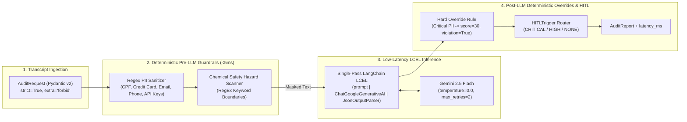

# System Architecture & Technical Design Decisions

This document explains the architectural evolution, deterministic privacy guardrails, latency optimization (`~15s -> <2.0s`), and Human-in-the-Loop (HITL) safety overrides governing `qualityops-ai-agent`.

---

## 1. System Topology & Data Flow

---

## 2. Key Architectural Decisions & Trade-Offs

### Decision 1: Architectural Pivot from CrewAI Multi-Agent (`~15s`) to Single-Pass LangChain LCEL (`<2.0s`)

* **Context:** Compliance auditing in high-volume Pest Control Operator (PCO) and field service call centers requires near-real-time supervisor visibility before a customer call escalates or closes without mandatory chemical safety warnings.
* **Initial Bottleneck (`src/agents/crew.py`):** The initial multi-agent CrewAI implementation orchestrated separate sequential agent roles (security auditor, protocol verifier, coaching writer). Sequential inter-agent handoffs produced 3–4 LLM round-trips per transcript, yielding ~15 seconds of end-to-end latency.
* **Chosen Production Architecture (`src/langchain_backend.py`):**
  1. **Single-Pass Declarative Chain:** Because the compliance rubric is fixed and deterministic, multi-agent role-play added latency and token overhead without improving audit precision. Replacing the CrewAI loop with a single LCEL pipeline (`prompt | llm | JsonOutputParser()`) collapsed 3–4 sequential network calls into one deterministic call using `gemini-2.5-flash` at `temperature=0.0`.
  2. **Offloading Deterministic Checks to Python:** PII scanning and chemical hazard keyword matching were removed from LLM prompts and executed via compiled RegEx in `<5ms` prior to model invocation.
* **Verification:** Deterministic pre-LLM guardrails, post-LLM hard overrides (`score=30` on critical PII), and HITL escalation contracts are verified offline against labeled regression fixtures in `tests/unit/test_audit_engine.py` and `eval/evaluate.py --mock` (`guardrail_p95_latency_ms < 5ms`), while end-to-end `< 2.0s` LLM inference SLA telemetry (`live_lcel_p95_latency_ms`, `AuditReport.latency_ms`) is measured via `time.perf_counter()` when executed in live provider mode (`GEMINI_API_KEY`).

---

### Decision 2: Deterministic Pre-LLM PII Sanitization (`src/guardrails/pii_sanitizer.py`)

* **Context:** Sending raw customer call transcripts directly to external LLM endpoints risks leaking Brazilian CPFs, payment card numbers, emails, phone numbers, or pasted API credentials—violating **LGPD**, **GDPR**, and **PCI-DSS**.
* **Chosen Architecture:** `sanitize_text_and_extract_violations()` executes compiled RegEx sweeps *before* constructing the LLM prompt, replacing raw values with structural tokens (`[REDACTED_CREDIT_CARD]`, `[REDACTED_CPF]`, `[REDACTED_EMAIL]`, `[REDACTED_PHONE]`, `[REDACTED_API_KEY]`) while recording masked audit metadata (`PIIViolation`).
* **Limitation & Evolution:** RegEx provides deterministic zero-latency masking for structured formats but cannot detect contextual PII (e.g., spoken full home addresses or unstructured names). Production scale-up should pair RegEx with a local NER/DLP model (e.g., Microsoft Presidio) before external inference.

---

### Decision 3: Post-LLM Deterministic Safety Overrides & HITL Routing

* **Context:** Stochastic LLM outputs can occasionally assign lenient scores even when a critical compliance violation occurred earlier in the interaction, or when adversarial prompts attempt social-engineering coercion.
* **Chosen Architecture (`_evaluate_hitl_escalation` & `execute_compliance_audit`):**
  1. **Zero-False-Negative Override:** If pre-LLM sanitization detected any `CRITICAL` PII leak (`CREDIT_CARD` or `API_KEY`), Python deterministically overrides LLM scoring (`score = min(score, 30)`, `security_violation = True`, `eval_metric_pass = False`) regardless of model output.
  2. **Immediate Escalation Triggers:** `HAZARD_KEYWORDS_PATTERN` (`chemical`, `corrosive`, `toxic`, `spill`, `leak`, `flammable`, `chlorine`, `ammonia`) or `CRITICAL` PII automatically elevates `HITLTrigger(priority="CRITICAL", required=True)` for supervisory intervention.
  3. **Fail-Closed Missing-Credential Mode:** When `GEMINI_API_KEY` is absent, `execute_compliance_audit()` still runs deterministic PII and chemical hazard scanning and returns a structured `AuditReport` with `HITLTrigger` alerts rather than silently passing unverified calls.
